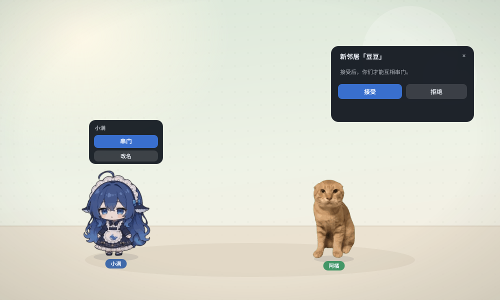
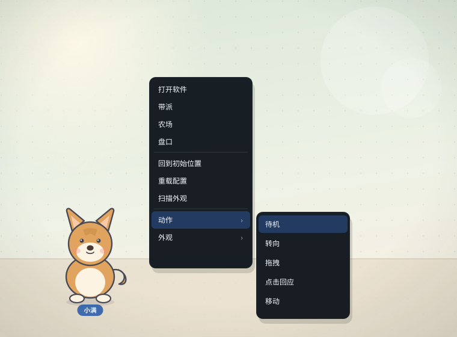
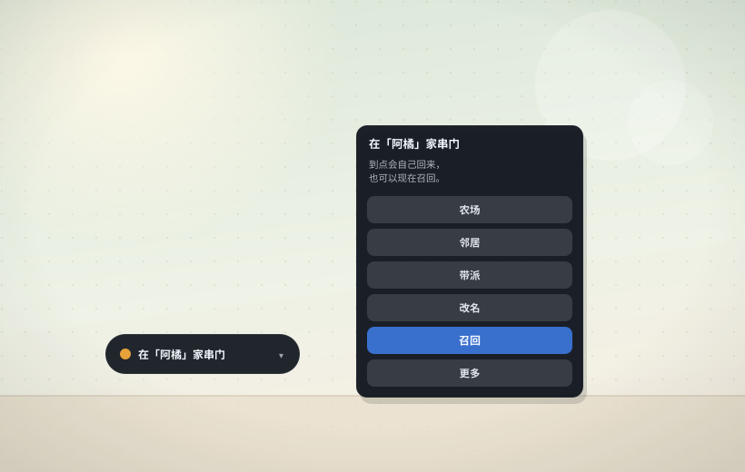
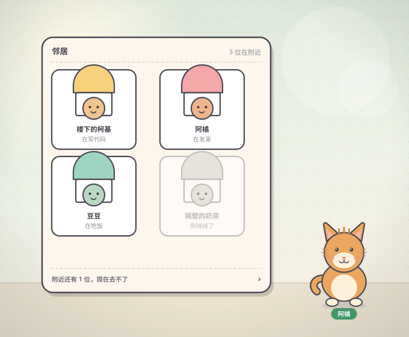
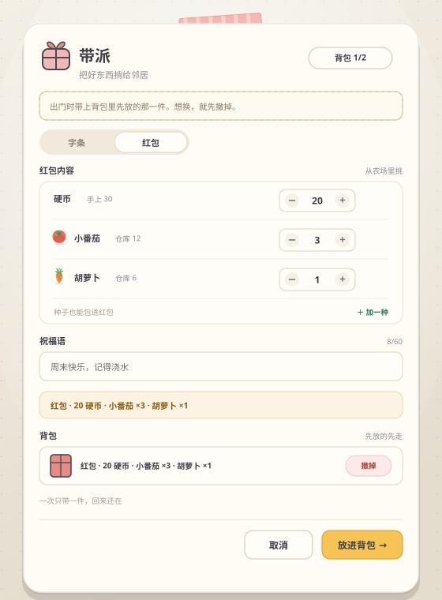
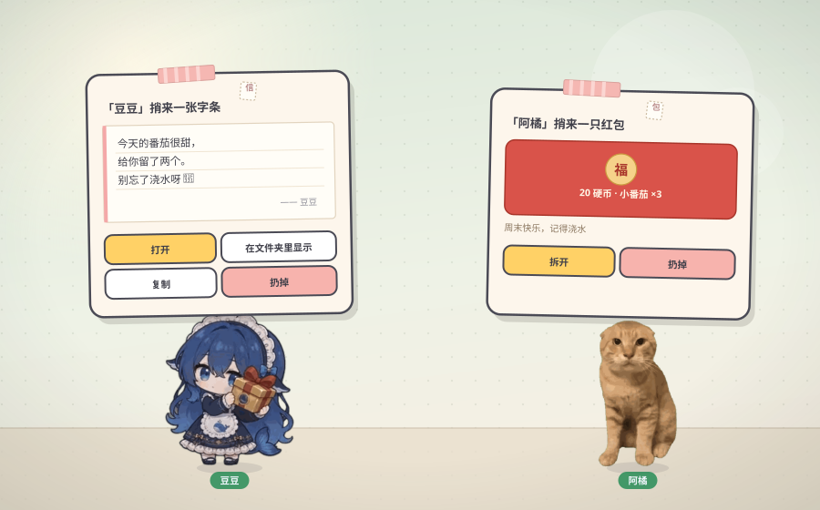
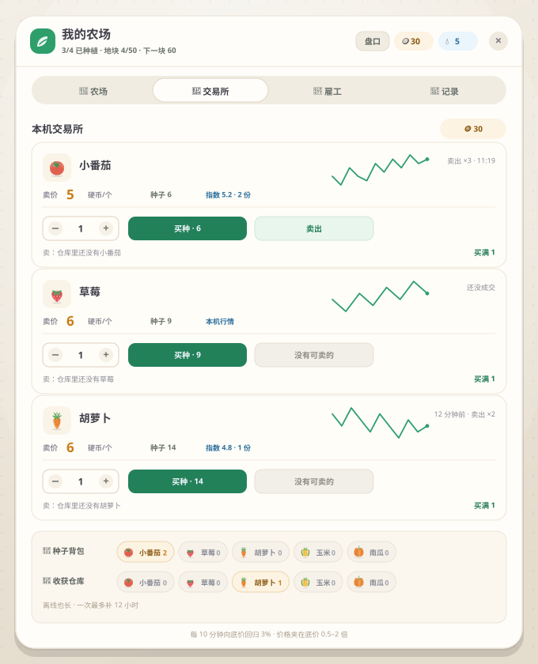
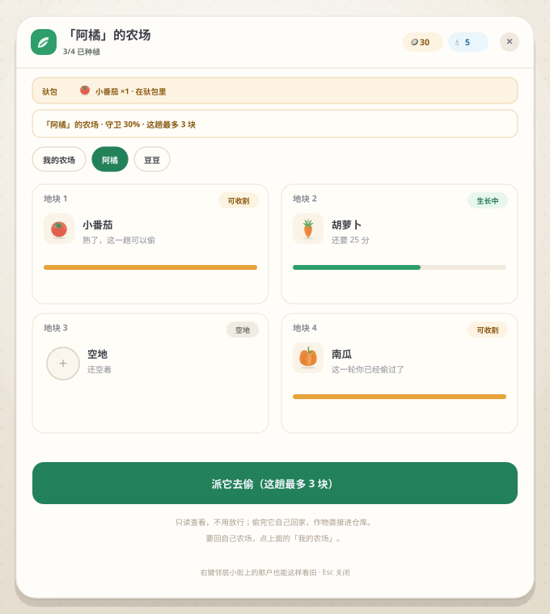
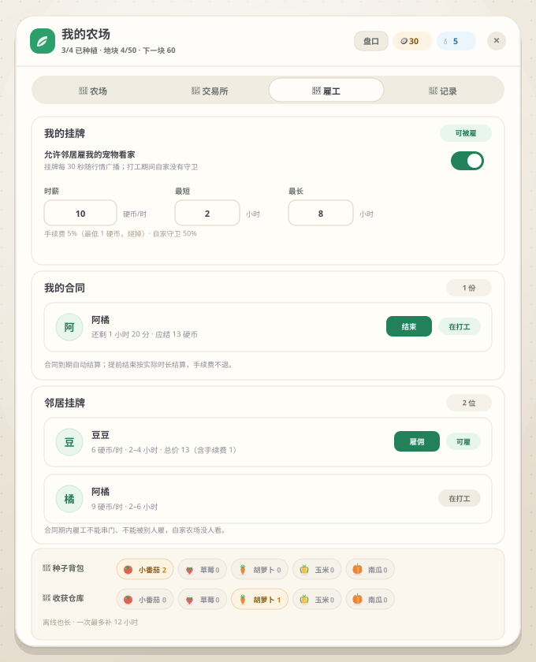
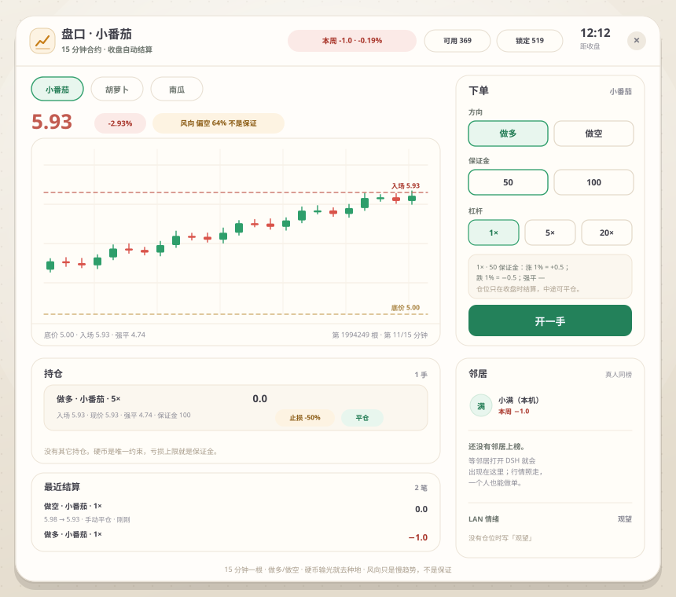

<p align="center">
  
</p>

# dsh-zoo

<p align="center">局域网里的 DSH 宠物：会串门，会带东西，还能种地、偷菜和做盘口。</p>

<p align="center">
  <a href="https://github.com/Diomchen/dsh-zoo/actions/workflows/ci.yml"></a>
  <a href="https://github.com/Diomchen/dsh-zoo/releases/latest"></a>
</p>

dsh-zoo 是给 DeepSeek Harness 装的插件。装上之后，你的桌面上会多一只宠物；
同一个局域网里的另一台机器上也装一只，它们就会互相看见、互相串门，还会带一张字条
或一个文件过去。

不用账号，不用服务器，也不用端口映射。两台机器在同一个网段、都开着 DSH，
剩下的它自己会做。

> 只想先跑起来？直接跳到 [三分钟上手](#三分钟上手)。

> 下面这些图都是**示意图**，不是真实截图。桌面上的宠物来自 `dsh-pet`，长什么样由你装的
> 素材决定；图里用柴犬、橘猫和兔子，只是因为它们比通用小人好认。图是 SVG，源文件在
> [`assets/screens/`](assets/screens/)，想改文案或配色直接编辑就行。

## 先看一眼

<p align="center">
  
</p>

<p align="center"><em>桌面上：自己的宠物、来串门的邻居，以及第一次见面时的放行卡。</em></p>

## 它能陪你做什么

- **桌面上的宠物**：全屏透明、置顶、默认点击穿透；有重力，可以抓起来拖走，松手还会按轨迹飞出去。
- **找到邻居**：同一网段自动发现，不用填 IP。第一次见面先弹一张卡，你点了「接受」才能互相串门。
- **去串门**：点「串门」会先打开一条小街，谁在线、在干嘛、能不能去，一眼能看到。
- **带点东西**：出门前捎一张字条、一个文件，或者包一只红包；到了对方家，礼物卡就贴在访客旁边。
- **农场**：种、收、浇水、施肥、解锁地块；离线也长，DSH 开着就攒露水。
- **四季和节日**：一天一季，四天一轮；当季有专属作物，每天有一个小节日，还有四季来客上门。
- **偷菜和帮忙**：去邻居家偷成熟作物，或者给生长中的地浇水；守卫和每日上限随农场规模变大。
- **看田和派它去偷**：在家右键邻居小街上的那户就能看田，不用放行；点「派它去偷」让它自己跑一趟。
- **雇工**：挂牌出租自己的宠物看家；合同 2–8 小时，工资预付，按实际时长结算。
- **交易所**：本机做市，买种子、卖作物；邻居的行情汇总成局域网指数。
- **盘口**：15 分钟合约，做多/做空、1×/5×/20×/50×/100×、开平各 0.2% 手续费、农场硬币下注、真人周榜（按收益率排）。
- **多外观**：用 `skin.json` 注册素材源；换皮不动名字、身份、记录和农场。

> **平台**：桌面宠物支持 **macOS / Windows**。Linux 或 web profile 没有桌面层，
> 但发现、放行、串门、农场数据照常工作，只是看不到宠物和那几扇小窗。

## 三分钟上手

**要求**

- DSH Desktop（web profile 也可以，只是没有桌面层）
- `dsh-pet`（提供宠物、动作和素材；不装也能跑，只是显示通用小人）
- Node.js ≥ 22.12
- Electron 运行时（装过 `dsh-pet` 后通常已有；没有就不会显示桌面宠物）

**安装**

```sh
git clone https://github.com/Diomchen/dsh-zoo.git
cd dsh-zoo
node scripts/install.mjs            # 装进 ~/.dsh/profiles/desktop
node scripts/install.mjs --dry-run  # 先看会改什么
node scripts/install.mjs --profile web
```

装完**重启 DSH**。确认接口是否正常：

```sh
curl -s http://127.0.0.1:<DSH端口>/dsh-zoo/state | jq '.neighbors'
```

`<DSH端口>` 是 DSH GUI 地址里的那个本地端口（比如 `http://127.0.0.1:62884` 里的 `62884`）。

**卸载**

```sh
node scripts/uninstall.mjs
```

用户数据在 `~/.dsh/dsh-zoo/`，卸载不会删除。想彻底重开，再手动删这个目录。

## 第一次打开

1. **找到它**：桌面上会多一只宠物。鼠标悬停，旁边弹出「串门 / 改名」；右键它，是完整菜单。
2. **等邻居来敲门**：另一台机器也装好后，你的桌面上会出现一张「新邻居」卡。点「接受」，
   你们才能互相串门；点「拒绝」会记进名单，以后不再问；点 × 只是这次不理会。
3. **去串门**：点「串门」打开邻居小街，点哪户就去哪家；去不了的那户会写原因。
   宠物到了对面会一直待着，直到你送客、召回，或满 30 分钟。
4. **带点东西**：右键自己 →「带派」，写张字条、选个文件，或者包个红包。东西放进背包，
   出门时自动带上；对方点开卡片才算收到。
5. **种地**：右键「农场」打开小窗。开局 4 块空地、30 硬币、2 颗小番茄种子，
   点空地就能种；熟了会轻轻跳一下，点「收获」。

## 桌面上会发生什么

<p align="center">
  
</p>

| 操作 | 结果 |
| --- | --- |
| 悬停自己 | 弹出「串门 / 改名」；它不在家时桌面换成胶囊（见下） |
| 右键自己 | 打开软件 / 带派 / 农场 / 盘口 / 回到初始位置 / 重载配置 / 扫描外观 / 动作 / 外观 |
| 拖动宠物 | 抓起来，松手按轨迹投掷 |
| 点访客 | 送客 |
| 点礼物卡 | 打开 / 在文件夹里显示 / 复制（字条）/ 扔掉；红包是「拆开」 |
| 右键「农场」 | 打开农场小窗；再点一次、点 × 或按 Esc 关闭 |
| 右键「盘口」 | 打开盘口小窗；再点一次、点 × 或按 Esc 关闭 |
| 拖盘口窗 | 按住标题栏的 `⠿` 握把拖动；松手位置会记住 |
| 点窗口外面 | 农场 / 带派 / 改名 / 盘口四扇小窗一起收起 |

右键菜单里的「重载配置」会重读 `settings.json` 和 `skin.json`，并重建桌面，不会占用崩溃退避次数。
菜单只挂自己的宠物：访客和空白桌面都不会弹。

### 宠物不在家的时候

<p align="center">
  
</p>

宠物去串门、去偷菜或在邻居家打工时，自己的桌面上会留一个胶囊，写清「在谁家 / 去偷菜了 /
在谁家打工」。点开是面板：农场 / 邻居 / 带派 / 改名 / 召回（打工时是「叫它回家」）/ 更多；
右键胶囊直接开完整菜单。

胶囊可以拖走：它默认停在宠物最后出现的位置，挡住视线就拖到边上，松手停在那里，
本次运行一直记住。拖过不算点击，不会误开面板。

## 邻居和串门

<p align="center">
  
</p>

**发现**是 UDP 广播，自动找到同一网段的邻居。每台机器一只宠物，一个 DSH 实例养一只。

**放行**是双向的：你接受对方，对方也接受你，才能互相串门。放行只按 `deviceId` 认，
改名字、换外观都不影响。

**小街**里每户一张小房子：名字、现在在干嘛、能不能去。能去的第二行是它的状态（写代码、发呆、
吃饭……），去不了的写原因（「你还没放行它」「它还没放行你」「刚掉线了」）。左键去串门，
右键看田，两个手势不抢。

**串门**最多 30 分钟，到点它自己回家。访客会在你桌面上一直待着，直到你点它送客、对方召回，
或对方到点回家。一次串门在双方各留一条记录，保留最近 200 条。

**自动出门**默认关。打开后还要同时满足：最近 10 分钟有活动、距上次出门 ≥15 分钟、
存在在线且互相放行的邻居；满足才随机挑一位出门。

**跨版本**：0.3.x 及更早版本不认礼物字段，串门照常，但礼物会显示「没送到」并退回背包。
旧版本邻居看不到农场入口，偷/帮/雇/行情需要双方都是 v1.1 以上。

## 带派：出门捎点东西

<p align="center">
  
</p>

右键自己 →「带派」打开小窗。可以放一张字条、一个文件，或者包一只红包；也可以用 HTTP 的
`bring` 动作直接放进背包。到了邻居家，东西留下，访客旁边出现礼物卡。

**对方收下并回了回执才算送到**，否则串门结束时东西退回背包；打开卡片只是看内容。
礼物永远不会自动打开或执行：打开、显示、复制、扔掉、拆红包，都只在用户点卡片时发生。

<p align="center">
  
</p>

| 项 | 限制 |
| --- | --- |
| 字条 | ≤500 字 |
| 文件 | ≤16 MiB |
| 红包 | 硬币 ≤200，每种作物/种子 ≤20，作物和种子各 ≤5 种，祝福语 ≤60 字 |
| 背包 | 最多 2 件，先放的先带走 |
| 一次串门 | 只带背包里先放的一件 |
| 收件箱 | 总量 ≤500 MiB、≤200 件 |
| 频率 | 同一邻居 ≤10 件/小时、≤50 件/天；红包另限每天 3 只 |

### 红包

红包和字条/文件不一样：**寄出时就先从你的农场扣掉**，放进背包；对方点「拆开」才真正进他的农场。
没拆的红包 24 小时后自动退回（人不在线就等他下次上线补退，不会凭空消失）。

- **寄**：带派小窗切到「红包」，填硬币、仓库作物、种子袋种子（只列你现有的），可写一句祝福语。
  右下角实时显示「红包 · 20 硬币 · 小番茄 ×3」；一件都没填时「放进背包」是灰的。
- **收**：访客卡片显示红包内容和一个「拆开」按钮；拆开后卡片写「已拆」，内容直接进农场。
- **退**：背包里还没带出门的红包可以撤回来，东西原样退回农场；已经拆开的不能再拆，也不会被退回。
- **看得见**：没拆的红包卡贴在自己宠物旁边，访客走了也不会跟着消失，直到拆开或 24 小时退回；
  1.10.0 起红包在 `farm.json` 里单独记一份 `packetLog`（≤50 条），农场「记录」页顶上钉一块
  「红包记录」，收到 / 拆开 / 送出 / 退回各一句——流水只留 100 条，红包不会半天就被收菜记录挤没。
- **账本**：拆开/退回都落盘，重发或重放请求不会发第二次。
- **老版本**：红包是 1.6.5 才有的。对方没在心跳里声明 `packet` 能力时，红包不会跟着出门——
  留在背包里，并提示「对方版本还不支持红包」。1.7.2 起才会声明这个能力。

礼物卡的正文按纯文本渲染，不解析 HTML/Markdown。细节和完整动作见
[`docs/protocol.md`](docs/protocol.md)。

## 农场

<p align="center">
  
</p>

农场属于**身份**：换皮、改名都不动它。开局是 4 块空地、30 硬币、2 颗小番茄种子、0 露水；
第一次打开就能直接种。

小窗有四个页签：**农场 / 交易所 / 雇工 / 记录**。顶部是「我的农场 / x/y 已种植」、
季节日历、硬币和露水；农场页下面是今天的节日卡、来客卡，再下面是地块网格。
地块网格跟着 `farm.plots` 自适应：开局 4 块、最多 50 块；已解锁的地块后面跟着一张
「下一块」锁定卡，写着地价。

### 作物

**常驻作物**（六种，四季都能种）：

| 作物 | id | 生长 | 种子价 | 产量 | 交易所底价 |
| --- | --- | --- | --- | --- | --- |
| 小番茄 | `tomato` | 30 分钟 | 6 | 3 | 5 |
| 草莓 | `strawberry` | 45 分钟 | 9 | 4 | 7 |
| 胡萝卜 | `carrot` | 2 小时 | 14 | 5 | 6 |
| 玉米 | `corn` | 4 小时 | 22 | 6 | 9 |
| 南瓜 | `pumpkin` | 8 小时 | 36 | 3 | 30 |
| 葡萄 | `grape` | 12 小时 | 52 | 5 | 24 |

**四季作物**（只在所属季节能买、能种；收获后随时能卖）：

| 作物 | id | 季节 | 生长 | 种子价 | 产量 | 交易所底价 |
| --- | --- | --- | --- | --- | --- | --- |
| 豌豆 | `pea` | 春 | 25 分钟 | 6 | 3 | 6 |
| 西瓜 | `watermelon` | 夏 | 6 小时 | 30 | 8 | 24 |
| 稻米 | `rice` | 秋 | 3 小时 | 18 | 10 | 10 |
| 白萝卜 | `radish` | 冬 | 90 分钟 | 10 | 6 | 8 |

初始种子只有小番茄，其他种子去交易所买。表按生长时长排，窗口里的种子列表和行情页也是这个顺序。
常驻作物越久的一档种子越贵、每小时毛收越低，但种下去管得更久——短的刷得勤，长的适合睡前种。
四季作物的底价刻意高于常驻作物：它们只在当季能种，作为补偿，当季按底价卖的日收益也高于草莓；
价格跌到地板时仍不亏。

外观是包里自带的 SVG（`desktop/crops/<id>.svg`），不是 emoji；没有图的作物（老版本邻居
传来的、或将来漏放的）退回 emoji 显示。

当季种下长得快 10%；跨季没熟的四季作物会在本地午夜枯萎（不能收、不能浇水/施肥，
但可以点一下重种）。六种常驻作物不受季节影响，也不会枯萎。

### 加自己的作物（不用改代码、不用重装）

在数据目录放一个 `crops.json`（默认 `~/.dsh/dsh-zoo/`；Windows 是
`%USERPROFILE%\.dsh\dsh-zoo\`；设了 `DSH_HOME` 就跟着走），**2 秒内自动生效**，不用重启：

```json
{
  "version": 1,
  "crops": [
    { "id": "blueberry", "name": "蓝莓", "growMs": 5400000,
      "seedPrice": 30, "yield": 4, "base": 18 }
  ]
}
```

- `id` 只认小写字母开头、2–24 位的 `a-z 0-9 _ -`；`name` 最多 16 字；
  `growMs` 1 分钟–30 天；`seedPrice` / `base` 是正整数，`yield` 1–99。
  越界的**整条丢掉**（不做部分修补），日志里留一行。
- 加进去以后：交易所多一种行情、种子列表多一行、地块能种能收能卖，和内置作物一样。
- 数值自己负责：`seedPrice` 太低 + `yield` 太高就是刷钱。
- 外观暂时退回 🌱（自定义作物的图还没接；内置十种仍是包里的 SVG）。
- **局域网里会自动同步**：beacon 只带目录指纹，邻居发现不一样就单播拉一次完整目录
  （每片 ≤8 条、30 秒最多问一次）；图走局域网 HTTP，按内容哈希取，取不到就退 🌱。
  同一网段里你加一种作物，别人的窗口几十秒内也会多一种。
- **哪些会听你的**：本机 `crops.json` 永远赢；不同机器给同一个 id 写了不同数值时，
  按定义内容哈希字典序小的那一份收敛（不是「我先到」）。目录只增不减：删掉定义不会
  把别人地里的作物变空地。
- 老版本邻居不认这两个报文，它看到的新作物仍是空地、行情里也没有；反方向正常。
- 信任边界：任何**被发现**的邻居都能同步目录，所以数值会被 clamp（`growMs` 1 分钟–30 天、
  `yield` 1–99 等），本地市场也只在 `[base×0.5, base×2]` 内认价。详见
  [ADR-0019](docs/adr/0019-runtime-crops-over-lan.md)。

### 一天一季，四天一轮

季节按**本机日历**走：春 → 夏 → 秋 → 冬，一天一季，四天一轮，本地午夜换季。
锚点是 `2026-10-26` = 春；比如 `2026-11-13` 是秋，`11-14` 00:00 入冬。
季节不写进存档，只由时间算出来，所以改系统时间会直接改变看到的季节。

- **日历**：窗口顶部四格（春/夏/秋/冬），今天高亮，节日带小图标，最后一格显示
  「距入冬 8 小时 12 分」。最后 4 小时会提示「今晚 24:00 换季，未熟四季作物会枯萎」。
- **当季加成**：四季作物在所属季节生长快 10%；常驻作物没有加成，也没有惩罚。
- **换季枯萎**：本地午夜，所有**没熟**的四季作物变成「枯萎」；已经成熟的不受影响，
  仍可收获。枯萎地不能收/浇水/施肥，但可以直接重种。

### 节日

每个季节一个节日，全天可做，本地午夜结束；完成后在节日卡上领一次奖励，重复领会被拒绝。
换季后前一天的进度作废。

| 季节 | 节日 | 做法 | 奖励 |
| --- | --- | --- | --- |
| 春 | 播种节 | 种下 8 株 | 30 硬币 + 3 露水 |
| 夏 | 夜市 | 卖出 8 个作物 | 40 硬币 + 3 露水 |
| 秋 | 丰收祭 | 收获 15 个作物 | 50 硬币 + 4 露水 |
| 冬 | 围炉节 | 浇水 5 次 | 35 硬币 + 6 露水 |

### 四季来客

每个季节有一位来客：**蛙雨/野火在 09:00–19:00 之间随机出现，熊獾/巨鹿固定本地 15:00 出现**，
每次只待 **3 小时**；窗口外不显示卡片，也不能结算。窗口结束时还没处理，会按「不管它」结算一次。
来客是一张二选一卡片，不打架、没有实时战斗：

| 季 | 来客 | 守卫 | 成功 | 失败 | 安抚 | 不管它 |
| --- | --- | --- | --- | --- | --- | --- |
| 春 | 蛙雨 🐸 | 赶走 | 45 硬币 + 3 露水 + 1 颗豌豆种 | 踩坏 2 块正在长的地 | 引水：1 露水 | 踩坏 1 块地 |
| 夏 | 野火 🔥 | 隔离 | 55 硬币 + 4 露水 + 1 颗西瓜种 | 烧掉 2 块成熟作物 | 浇水：2 露水 | 烧掉 1 块地 |
| 秋 | 熊獾 🐻 | 守夜 | 70 硬币 + 5 露水 + 1 颗稻种 | 搬走 5 个仓库作物 | 投喂：3 个仓库作物，换 1 颗稻种 + 2 露水 | 搬走 2 个作物 |
| 冬 | 巨鹿 🦌 | 硬扛 | 65 硬币 + 6 露水 + 1 颗白萝卜种 | 冻住 3 块地 | 生火：2 露水 + 10 硬币 | 冻住 2 块地 |

守卫成功率和主人是否在家、是否有雇工有关（0.3 + 0.5，封顶 0.8）。来客卡上还能临时雇
**0–2 名守卫**：每名 20 硬币、加 0.5 成功率，和常驻守卫相加后封顶 100%；硬币在结算时先扣，
失败不退。临时守卫只能从**当前空闲的宠物**里来：在线、互相放行、且没在自家打工/串门的邻居才算；
没有空闲宠物时，只能自己守，不能加雇。安抚不掷骰，付得起就稳过。

来客卡只在主人视图出现，访客和看田看不到。失败/忽略不会删存档，也不会扣未提及的资源。

**冻住的地**：作物还在，但停止生长，不能收获/浇水/施肥，也不能直接重种；点「生火解冻」花
2 露水 + 5 硬币即可恢复。到换季还没解冻，这块地会冻死成「枯萎」，只能重种。也可以直接「铲除」
清空，省下解冻费，但作物同样没了。

### 怎么玩

- **种 / 收**：右键「农场」打开小窗；点空地卡片弹出播种底部弹窗，选种子种下；成熟后点「收获」。
  也可以「一键种满」（按空地与种子库存逐块种下）或「一键收割」（所有成熟地块顺序收获）。
  产量 = 表里的产量 + 施肥 1 − 被偷数量（最低 0）。
- **解锁地块**：第 5 块起用硬币永久解锁，最高 50 块；只能按顺序买，不退不卖。
  地价 `round5(60 × 1.10^(已解锁−4))`：第 5 块 60，第 10 块 95，第 20 块 250，
  第 30 块 650，第 40 块 1,685，第 50 块 4,375；全部解锁共约 47,500 硬币。
  解锁即时完成，但**至少留 6 硬币买一颗种子**；金币直接烧掉，不进任何人的口袋。
  锁着的地块不能种/收/偷/帮；访客只看得见你已解锁的地。
- **浇水 / 施肥**：每株各一次。浇水花 1 露水，+10% 生长；施肥花 5 露水，收获 +1。
  露水不够会明确报 `no-dew`。
- **铲除**：生长中或冻住的地可以「铲除」，免费清空，不退种子、不产作物；点第一次变成
  「确认铲除？」，4 秒内再点一次才真的铲。成熟要先收割，枯萎直接点一下重种，空地不用铲。
- **在线 / 露水**：DSH 开着就按时间攒；每 10 分钟 +1 露水，种/收/浇/施肥/买卖/雇佣
  都不会打断计时。每天最多新增 48，余额也封顶 48；本地午夜只重置「今天已挣」的额度，
  保留未花完的余额。
- **离线生长**：关掉 DSH 作物仍按真实时间长；一次最多补 12 小时，回来接着长。

### 交易所与行情

<p align="center">
  
</p>

交易所是农场自己的小市场：买种子是固定价，卖作物按本机 `bid`。卖多了价跌，每 10 分钟向底价回归 3%；
价格永远夹在底价的 0.5–2 倍。买种子不影响作物价。

卖价冲击的分母随农场规模放大（`5 × 已解锁`）：4 块时仍是 20，50 块时 250，
所以「一茬全卖」在哪个规模都约跌 7–9%（单笔上限 99，150 个要分两笔）。每行有数量步进器
和「买满 / 全卖」两个快捷量（只改数量，不直接成交；买满会同时受硬币与 999 上限约束）。
硬币不够、仓库没货时按钮上直接写「差 6 硬币」「没有可卖的」，旁边再留一行原因，
不会点了没反应。

**行情**每 30 秒（或价格/挂牌变化时）向放行邻居广播一次本机价格与挂牌。各家取 2 分钟内
新鲜样本的中位数混成局域网指数，成交仍在本机。指数权重按邻居数 1 / 2 / 3+ 家为
45% / 65% / 75%，再乘作物 beta（番茄、草莓 0.8，胡萝卜、稻米 1.0，玉米 1.1，南瓜 1.3，
西瓜、葡萄 1.4），封顶 85%；邻居最近一轮涨跌的中位数再形成 ±12% 动量。权重越高，
本机卖价越跟邻居走；没有新鲜邻居时仍是「本机行情」。行情行会写「指数 52% · 2 家 ↑3.0%」，
样本过期后画灰并退回本机价。

卖价下面还有一条 24 小时成交价折线：取最近 50 笔里这个作物的成交，再补上当前卖价；
每个成交点悬停时在点的上方弹出「日期 时间 · 单价」，右侧固定写「24h 卖价」不随悬停变化；
没有成交时画一条虚线并写「24h · 暂无成交」，不会伪造行情。

### 偷菜、帮忙和看田

串门时打开农场窗进入访客视图。成熟的地可以偷 1 个；生长中的地可以帮一次
（花 1 露水、+10% 生长、得 1 硬币）。偷菜成功会让主人收获少 1；被抓只是这次白跑。
两种互动都有每日上限和每块地每轮一次的限制。

<p align="center">
  
</p>

**看田**不用放行：右键邻居小街上的那户（或农场窗顶部的邻居切换器）就能在家看邻居的地。
只读，只有地块、守卫和这趟最多几块。看田窗会一直停在那一页——行情摘要、自家作物成熟、
邻居来偷都不会把它踢回自己农场；倒计时到点只会重拉一份对方的新视图，要回自己农场得点
顶部的「我的农场」。

看田窗底部的「派它去偷」让宠物真的出门跑一趟——不用放行、也不用先串门；它出现在对面的
桌面上，带「偷菜」角标，把这一趟能偷的都偷完就自己回家，作物回家时已经在仓库里。
对方版本太老（没有 `raid` / `look`）时，切换器那一项会写「对方版本太老」。

### 雇工

<p align="center">
  
</p>

雇工页保存自己的挂牌（开关 / 时薪 / 可雇时段）。邻居的挂牌随行情摘要过来，选宠物和时长
就能雇。工资 + 5% 手续费预付；雇工出现在雇主的桌面上（带「打工」角标），雇主守卫
0.3 + 0.5 = 0.8 封顶；来客结算时还可另雇 0–2 名临时守卫，最多把这一次的成功率推到 100%。

合同期内雇工不能串门、不能被别人雇，**自家农场没人看**。主人可以召回，雇主可以提前结束，
按实际服务时长结算；手续费不退。宠物在外打工时自家桌面上留一个「在「X」家打工」胶囊：
点开能开农场窗、能带派、能改名，也能一键「叫它回家」——不用等合同到点。

<details>
<summary><strong>农场完整限额</strong></summary>

| 项 | 上限 |
| --- | --- |
| 地块 | 起始 4 块，最多 50 块（`p1`–`p50`），按顺序解锁 |
| 作物 | 10 种（6 常驻 + 4 四季） |
| 季节 | 1 天/季，4 天一轮，本地午夜换 |
| 节日 / 来客 | 每日 1 个节日，完成领 1 次；每季 1 位来客，春夏 09:00–19:00 随机 / 秋冬 15:00 固定，持续 3 小时 |
| 硬币 | 1,000,000 |
| 每种种子 / 作物 | 999 |
| 露水 | 每天最多新增 48，余额上限 48；午夜只重置新增额度，不清余额 |
| 离线生长 | 一次最多补 12 小时 |
| 农场日志 | 文件 200 条；`/state.farm.log` 20 条；窗口记录页 100 条 |
| 驮包 | 只显示：偷来的作物到本次串门结束；工资到合同结算 |
| 行情历史 | 文件 200 笔；`/state.market.history` 50 笔 |
| 合同 | 每侧 20 条（未结算的不淘汰） |
| 偷菜 | 同一访客对同一农场 `3+floor((n−4)/10)`/天；同一农场 `5+floor((n−4)/5)`/天；同一访客 `10+floor((n−4)/10)`/天；每块地每轮 1 次 |
| 帮忙 | 同一访客对同一农场 `3+floor((n−4)/10)`/天；同一农场 `5+floor((n−4)/5)`/天；同一访客 `5+floor((n−4)/10)`/天；每块地每轮 1 次；每次 1 露水、+1 硬币 |
| 行情广播 | 每个 peer 30 秒最多 1 条；只认 2 分钟内、价格在 `[base×0.5, base×2]` 的样本 |
| 行情指数 | 邻居数 1/2/3+ → 45%/65%/75%，× 作物 beta，封顶 85%；动量 ±12%；样本仍只认 2 分钟内 |
| 买卖 | 单次 1–99 个；每分钟最多 10 笔（买 + 卖共用） |
| 价格 | 夹在 `base×0.5`–`base×2`；`bid = round(effective × 0.9)`；每 10 分钟回归 3% |
| 幂等缓存 | `farm-action` 按 `${deviceId}:${requestId}` 留最近 200 条 / 10 分钟；`work-*` ack 留 200 条 / 10 分钟 |
| 雇佣 | 时薪 1–100，时长 2–8 小时，手续费 `ceil(工资 × 5%)`、最低 1 |
| 守卫 | 主人在家 0.3 + 雇工 0.5，相加封顶 0.8；来客卡可另雇 0～2 名临时守卫（20 硬币/名，各 +0.5），一次结算封顶 1.0；宠物串门/打工时自家为 0 |
| 农场快照 | HTTP 响应 ≤64 KiB；访客宿主 2 秒超时，失败按地址冷却 60 秒 |

表里的 `n` 是当前已解锁地块数（4–50）；地价 = `round5(60 × 1.10^(n−4))`。
偷/帮的「同一访客/天」是访客本机跨农场账本，按**访客自己农场**的 `n` 算；其余按主人农场的 `n`。

</details>

<details>
<summary><strong>农场数据文件与降级</strong></summary>

农场三个文件和 `visits.json` / `backpack.json` / `trading.json` 同一套路：带 `version: 1`、可手改、可删；
损坏时按默认值运行并只告警一次；写入串行 + 临时文件 rename。删掉 `farm.json` 就是重新开局。

| 文件 | 内容 |
| --- | --- |
| `farm.json` | 硬币、种子、作物、露水、已解锁地块（最多 50）、挂牌、访客计数、农场日志 |
| `market.json` | 十种作物的 `base/price/volume24h/at`、最近 200 笔成交、局域网指数 |
| `contracts.json` | `outgoing`（我是雇主）与 `incoming`（我是雇工）两份合同列表 |
| `trading.json` | 本周盈亏、持仓、到价挂单、最近 200 条结算历史（不含硬币余额） |

| 情况 | 看到 |
| --- | --- |
| 旧版本邻居 | 串门、礼物、记录照常；没有农场入口，不能偷/帮/雇；行情忽略 |
| 没有桌面层 | HTTP 动作与 `state` 可用；没有农场窗，也没有雇工宠物 |
| 对方离线 | 不能去/偷/帮/雇；行情过期；合同按最后心跳结束 |
| 对方没开局域网端口 | 串门照常；农场快照取不到，不能偷/帮；雇工不可用 |
| 没有种子 / 硬币 / 露水 | 明确错误码 + 一句人话 |
| 合同一方离线 | 合同结束，按最后心跳结算；重连后按 `contractId` 幂等补发 |
| 坏 `trading.json` | 按空盘口运行、只告警一次；硬币不动，锁定中的保证金按坏账处理 |
| 盘口旧邻居 | 不认 `trading-digest`：盘口照常，榜上不出现他们 |
| 盘口 0 硬币 | 开仓/挂单按钮写「去种地」并禁用；农场露水/种子/节日照常 |
| 盘口时钟偏差 | 各自用本机 slot；邻居的图可能偏一根，本周盈亏是本地的，不依赖共识 |

</details>

## 盘口

<p align="center">
  
</p>

盘口是拿农场硬币押 15 分钟涨跌的小盘口：做多/做空、1×/5×/20×/50×/100× 杠杆、开平各 0.2% 名义费、收盘结算。
没有服务器、没有对手盘：行情由 `slot + 作物 + 版本盐` 的确定性底盘（v5）加每日消息面算出，
同一套代码、同一个时钟的两台机器得到同一张图；盘口的**真人资金流**以 P2P 事件带在 LAN 里传播
（无房主，正常 1–2 秒一致），开/平/止损/强平/到价成交都会以中等力度推动同一张图。
消息面是**确定性模板**，不联网、不调 AI；关键 K 上会插小旗，hover 能看见「发生了什么」和「谁推了盘」。

入口：桌面右键「盘口」，或农场窗顶部的「盘口」按钮；窗口约 760×700，再点一次 / 右上角 × /
Esc 关闭，关掉之后宿主仍然每分钟结算。窗口可拖标题栏移动，位置记在 Electron 的
`userData/board-window.json`（macOS 默认在 `~/Library/Application Support/dsh-zoo-desktop/`；
下次打开夹回当前工作区，离屏/坏文件回落居中）；点窗口外面（桌面/别的应用/宠物）会收起
盘口、农场、带派、改名四扇插件窗，正在输入法合成时这一条跳过（[ADR-0029](docs/adr/0029-window-drag-and-dismiss.md)）。

| 规则 | 怎么算 |
| --- | --- |
| 一根 | 15 分钟；一根里 15 个 1 分钟 tick；窗口画最近 24 根 + 当前形成中的一根 |
| 价格 | 锚在作物底价，夹在 `base×0.55`–`base×1.75`；分钟级随机游走 + 波动率聚集 + 早/夜盘时段 + 风暴 + 黑天鹅跳空（15 分钟 σ 约 2.3%），1 分钟之内不动、不插值；消息在公布那一分钟一次性跳价、72 小时慢衰减，没有「消息后持续漂移」；风向只给最近三根已实现动量 + 55–68% 置信度（不预示下一根） |
| 消息 | 每个作物每天 4–6 条 + 全市场 2–3 条；每天 5 个固定日程（09:30/12:00/15:00/20:00/22:30）提前 10 分钟预告、公布时跳价；微讯/快讯/头条/黑天鹅/风暴/传闻-证实六类；关键 K 画旗，hover 看标题/正文/影响 |
| 保证金 | 窗口只有预设 50 / 100 / 250 / 全下（= 此刻的全部可用硬币），没有自由输入框；宿主 / HTTP / 脚本还接受 1–1,000,000 的任意整数 |
| 杠杆 | 1× / 5× / 20× / 50× / 100×；1× 没有强平线（显示「—」）；50×/100× 的强平线分别只剩约 1.9%/0.95% 逆行，高杠杆是玩家选择，不是默认推荐 |
| 杠杆特效 | 选中的杠杆 chip 边框：1× 安静 / 5× 青风双环 / 20× 琥珀警戒脉冲 / 50× 紫电双环 / 100× 旋转彩虹环 + 放射速度线 + 心跳发光；切到 100× 会弹漫画气泡「老实赚钱，很枯燥吧。」；只提示风险，不改定价/强平/手续费；黑白模式转灰阶，reduced-motion 关闭动画 |
| 手续费 | 开平各 0.2% 名义价值（`保证金 × 杠杆 × 0.2%`），结算时一次扣清；下单区常驻「开平各 0.2%」 |
| 盈亏 | 做多 `保证金 × 杠杆 × (现价/入场 − 1)`；做空 `保证金 × 杠杆 × (1 − 现价/入场)` |
| 强平 | 做多 `现价 ≤ 入场 × (1 − 0.95/杠杆)`，做空相反（5% 维持保证金）；强平按强平线成交，亏损上限是保证金，硬币不会变负 |
| 止损 | 持仓卡上一键循环 关 / −25% / −50% / −100% 保证金；默认关，是玩家工具不是系统风控 |
| 结算 | 15 分钟收盘自动结算所有仓位；随时可手动平仓；强平/止损按剩余路径逐分钟检查，插针和离线都躲不过 |
| 挂单 | 点「到价」才出现目标价和「挂单」：价格碰到目标价就成交（成交价 = 目标价），最多活一根；收盘没成交自动撤并退回保证金，也可手动撤。不做部分成交、不跨机、不进历史 |
| 硬币 | 钱包就是 `farm.json` 的 coins；挂单/开仓当场锁保证金，平仓/结算/撤单退回 `保证金 + 盈亏` |
| 本周 | 周一 00:00 清零「本周交易盈亏」（已实现 + 未实现），硬币不跟着清零；收益率只展示 |
| 真人榜 | 本机 + 收到 `trading-digest` 的已放行邻居，按本周**收益率**降序（没报收益率的排最后，再按金币）；没有 NPC |
| 情绪 | 本机 + 邻居当前持仓的多空计数；一条仓位都没有时写「观望」 |
| 作物 | 跟随农场作物目录（**加一种就多一种**，含跨机同步来的；只列有底价的作物），作物条单行横滚（左右箭头 / 滚轮 / 键盘 ←→ Home End） |
| 快讯 | 图头下 16px 一条：最近一条消息 + 影响；右侧「资金流 +0.42%」；点开是详情卡（正文/来源/影响/今日日程） |
| 资金流 | 每个人开/平/止损/强平/到价成交发一条事件：500 名义 ≈ 0.30%，2 小时半衰期；单笔 ≤0.6%、单设备单根 ≤1.2%、单日 ≤4%、每作物水平 ≤1.5%；成交价含一半自身冲击，收盘结算不补流水 |

### 消息面与关键 K

- **关键 K**：有头条/黑天鹅/传闻，或 `|收盘/开盘 − 1| ≥ 4%`、近 24 根涨跌幅排前 3：K 线上方/下方画小旗
  （微讯只画 2px 小点，最多 3 面，超出写「+N」）。hover 便签在开/高/低/收下面多两行：
  「第 N 分钟 消息标题 · +1.4%」；点开是详情卡，含正文、来源、影响与今日日程。
- **传闻-证实**：先跳一次，5–20 分钟后可能再接一次「证实/辟谣」，方向独立（约 50/50），
  所以「看到消息就追」不是稳定正期望；日程只预告「何时/哪个作物」，不预告方向。
- **反套利**：消息公布后才可见、公布瞬间定价；底盘只改幅度不改方向；收益自相关仍 ≈ 0。
  这是票 102 修好的洞，v5 没有把它重新打开。
- **资金流**：自己的单也会推动图；成交价含一半自身冲击，往返净冲击≈0，自买自卖赚不到钱。
  邻居的单通过 `board-flow` 广播，新邻居/重连用 `board-flow-sync` 补最近 24 小时；
  单设备/单日上限在接收端复算，伪造事件最多把一根推动 ±1.2%。旧 peer 不认这个包，盘口照常，只是看不到他们的流水。
- **升级**：`PRICE_SALT` 升到 `board-v5`，旧图作废；`trading.json` 版本 1 → 2，
  未平仓位按新行情 re-base 入场价（PnL 从 0 开始），开仓时间/顺序不变。

### 看盘选项（蜡烛 / 折线、彩色 / 黑白）

顶栏「显示」里两组开关，改名不改数据、不影响结算：

- **图表**：`蜡烛`（默认，实体涨/空心跌）或 `折线`（收盘价折线 + 12% 面积 + 现价圆点；坐标轴、底价/入场/强平线、十字线便签照旧，便签仍显示开/高/低/收）。
- **配色**：`彩色` 或 `黑白`。黑白会把整个窗口（卡片、按钮、周榜、盈亏、品牌图）压成墨色/纸灰，涨跌改用**实心/空心 + ▲▼ + 正负号**区分，不只是换颜色——开会/老板路过时切一下就不显眼。
- 快捷键：`L` 切蜡烛/折线、`M` 切彩色/黑白（输入框、输入法合成中不触发）；偏好存在窗口的 `localStorage['dsh-zoo-board-prefs']`，重开窗口保留。
- 折线/黑白只影响“怎么看”，不改合约、持仓、硬币、周榜。

<details>
<summary><strong>盘口完整限额</strong></summary>

| 项 | 上限 |
| --- | --- |
| 杠杆 / 保证金 | 1× / 5× / 20× / 50× / 100×；窗口预设 50 / 100 / 250 / 全下，宿主 / HTTP 还接受 1–1,000,000 的任意整数 |
| 仓位 / 挂单 | 不设仓位上限（硬币是唯一约束）；挂单只活一根，收盘自动撤；窗口按最新在前、最多画 200 条，超出时表头写「显示最近 200」 |
| 止损 | 关 / −25% / −50% / −100% 保证金，四档 |
| 历史 | 文件 200 条；`/state.trading.history` 与窗口只取最近 50 条 |
| 价格 | 盘口价与到价目标价都夹在 `base×0.55`–`base×1.75`；消息 + 资金流合计偏离帽 ±6% |
| 消息 | 每个作物每天 4–6 条 + 全市场 2–3 条；窗口带最近 20 条全文 + 今日 5 条日程；K 线每根最多 2 条 lite |
| 资金流 | 单笔 ≤0.6%；单设备单根 ≤1.2%、单日 ≤4%；每作物水平 ≤1.5%；6 条/分钟、40 条/根；同步包 ≤16 条/包、最多 64 条/次 |
| 广播 | `trading-digest` 每个 peer 30 秒最多 1 条；只认 2 分钟内；positions ≤8；整包 ≤4 KiB |
| 周榜 | 周一 00:00 清零本周盈亏（硬币不清）；窗口最多画 32 行（本机 + 邻居） |

</details>

**成本只有两笔**：开平各 0.2% 名义费，和 5% 维持保证金对应的强平线；没有资金费、没有保险、没有单笔/总仓位上限，硬币是唯一约束。
输光了就去种地——农场的露水/种子/节日照常，那是农场的循环，不是交易的保险。
盘口与现货交易所互不影响：现货的 `market.json` 和盘口的行情是两张图，互不写入；
种田、买种、卖作物照旧。离线回来按确定性收盘价与路径补算，持仓不会因为关掉 DSH 消失。
旧版本邻居不认 `trading-digest`：盘口照常、榜上不会出现他们。
老窗口没有 `news` 字段也能画，只是没有消息旗子/快讯条；新窗口收到没有消息的包时，快讯条写「今日暂无消息，行情照走」。

## 期货

盘口是 15 分钟的涨跌彩票，期货是**真的市场**：一天一张合约、有到期日、有做市商报价、
可以和邻居互相成交、到期现金交割或转成现货作物。它不是盘口换皮，两者并存、互不写同一份状态。

入口：桌面右键「期货」，或菜单里的「期货」；窗口同样是 760×700，位置记在
`userData/futures-window.json`。关掉窗口不影响结算——结算是宿主的活。
第一次玩先看 [docs/play-futures.md](docs/play-futures.md)：一分钟上手、窗口地图、报错对照。

| 规则 | 怎么算 |
| --- | --- |
| 合约 | 每种作物每个交易日一张合约，代码 `<作物>-<YYYYMMDD>`（如 `tomato-20261117`），当天 00:00 上市、20:00 交割；20:00 到第二天 00:00 与周末都没有合约 |
| 一张 | 1 张 = 100 个该作物；下单按张数，保证金按名义算 |
| 杠杆 | 1× / 3× / 10× / 20×；保证金 = 名义 ÷ 杠杆 |
| 公允价 | 现货指数 × `exp(偏离)`；偏离是均值回归的随机游走（σ 0.4%、半衰期 30 分钟、每 15 秒一步），按合约各一条曲线，同一天的邻居看到同一条 |
| 报价 | 做市商连续报价：买一 = 公允 × 0.998、卖一 = 公允 × 1.002；吃单按对手价成交 |
| 成交路径 | 市价单先吃邻居挂着的单（同一合约、同一本账、价格不劣于做市商那一侧，按价格优先），剩下的张数才按做市商报价成交——所以「你赚的钱是邻居亏的钱」 |
| 费用 | 吃单 0.1% 名义 + 价差两侧各 0.2% + 交割 0.1%；费用的 90% 销毁、10% 进保险基金 |
| 结算 | 每 15 秒盯市一次（只把浮盈亏记进余额，仓位还在）；到期按交割价结清 |
| 交割 | 交割价 = 19:15 / 19:30 / 19:45 / 20:00 四根公允价收盘的算术平均，防尾盘插针 |
| 强平 | 逐 15 秒扫描价格路径，`保证金 + 浮亏 ≤ 0` 就按那一刻的公允价平掉；亏损上限是保证金 |
| 兜底 | 强平或交割收不上来的钱先由保险基金补，基金空了记欠账，余额永不为负 |
| 挂单 | 限价单最多挂 8 条，价格优先、同价先挂先成交；成交价取先挂那一单的价格；随时可撤，撤单退剩余冻结 |
| 转现货 | 随时把持仓按公允价换成作物入库（部分也行），保证金按张数比例释放；窗口里一笔一笔点「转」，也可以点持仓表头的「全部转」一次转完，钱不够或仓库放不下的那几笔会被跳过 |
| 托管 | 充值是农场硬币 → 托管账户；提现是托管 → 农场。农场硬币到 1,000,000 上限时，没退成的部分留在托管账待提取，不会丢 |

一个交易日的节奏：00:00 开盘（新代号、新的偏离曲线）→ 白天随时开平仓、挂单撮合 → 20:00 交割。
收盘那一刻，这张合约的仓位全部按交割价现金结清，没成交的挂单撤回、冻结保证金退回。
**交割只有现金一种**：想拿到作物，得在收盘前自己点「转」，按当时的公允价用托管余额买现货；收盘前 30 分钟窗口会亮红字提醒，并给出「全部转」的按钮。
20:00 到第二天 00:00 之间与整个周末都没有可交易的合约——期货不持仓过夜。

**跟谁成交**：市价开仓先吃邻居挂着的限价单——只吃同一合约、同一本账、价格不比做市商差的，按价格优先，成交价就是那张挂单的价；剩下的张数才按做市商对手价成交。限价单之间每 15 秒撮一次。所以你和邻居之间是零和的：你开出去的一张，就是他平不了的仓；跟做市商成交的那部分不进任何人的口袋。主动平仓仍按做市商报价走。

### 谁玩真钱、谁想歇会儿，都是自己说了算

房主只是记账员（`futures-host` 选举出来的那一台），**没有权力停别人的市，也没有权力退别人的钱**：

| 档位 | 会发生什么 |
| --- | --- |
| 纸面（`shadow`，缺省） | 撮合、盯市、强平、交割全跑，但只动托管账本里的纸面余额，农场硬币一分不动；纸面挂单只跟做市商成交，永远不吃真钱玩家的单 |
| 真钱（`live`） | 充值扣自己的农场硬币、提现加回；手续费与亏空进的是真钱保险基金 |

| 你按的 | 会发生什么 |
| --- | --- |
| 真钱（`live`）／纸面（`shadow`，缺省） | 见上表；这是**你这本账**的档位，跟邻居、跟房主都无关 |
| 暂停交易 | 只停自己：新仓、挂单被拒（`paused`），已开的仓和余额完好；平仓、撤单、转现货、提现照常 |
| 退出（回滚） | 只退自己：按当前价强平自己的仓、自己的余额退回自己的农场、这本账标 `disabled`；别人的账一分不动 |

三条命令都不需要房主同意：

```
POST /dsh-zoo/action {"action":"futures-account-mode","accountMode":"live"}
POST /dsh-zoo/action {"action":"futures-pause","paused":true}
POST /dsh-zoo/action {"action":"futures-rollback"}
```

窗口顶栏对应三颗按钮：「切到真钱／切到纸面」、「暂停交易／继续交易」、「退出」。
peer 的档位与暂停会以 `futures-mode` / `futures-pause` 报文报给房主，房主照办并把状态
随 `futures-settle` 回传（换机器/重装也认这个账户）。切档、暂停都写一条 `kind:'mode'` 流水。

> 1.12.0 之前，`off` 是房主手里的全局闸门，按一下全场停批发；`futures-rollback` 也是房主替
> 全场退款。这两条现在都不存在了：**一个人的按钮只能影响一个人**。老脚本里
> `{"action":"futures-mode","mode":"off"}` 仍能跑，但语义已经变成「暂停自己」。

### 敞口限额（任何人都能开户）

| 项 | 上限 |
| --- | --- |
| 单账户日交易额 | 5,000 币名义起，按账户权益 5 倍放大（本地 00:00 归零）；纸面账户同样按纸面权益算 |
| 同时持仓名义 | 20,000 币（仓位 + 挂单冻结） |
| 挂单 / 持仓条数 | 每账户 8 条挂单；peer 最多 8 条持仓（一条 `futures-settle` 装得下） |
| 同源地址限速 | 20 包 / 10 秒，超了静默丢 |
| 报文 | 单包 ≤4 KiB；房主把 `deviceId` 绑到 UDP 源地址+端口，换端口冒用无效 |

房主就是记账员：价格、成交、余额、强平全由房主算，客户端只发意图。房主掉线时网络里其余人
照常种田，期货停下等房主回来；托管余额记在房主账本里，不会因为某个 peer 退出而消失。
房主每 30 秒把**整本账**复制一份发给每个邻居（`futures-ledger` 分片），邻居只留最新的一份；
房主真的掉线、网络重新选举时，新房主用这份快照接管——余额、持仓、挂单原样回来，最多丢
最后半分钟的成交，不会丢钱。
1.12.0 起房主手里的「开关」只剩自己的那一份：他能暂停自己、退出自己，但停不了别人的市，
也退不了别人的钱——这是故意的，房主只是被选举出来的记账员，不是管理员。

**已知限制**：`deviceId` 没有签名，只能靠源地址绑定挡冒用；房主自己作恶无法防御（这是局域网
游戏，不是交易所）；同一台机器上开两个实例会互相抢端口，验双机请用两台机器或两个网络命名空间。

## 换一张皮

想用其他宠物包的外观，把它的动作目录写进 `~/.dsh/dsh-zoo/skin.json`。
下面这个例子来自 [`maodie-pet`](https://github.com/Edwardpch/maodie-pet)：

```json
{
  "sources": [
    {
      "id": "maodie-pet",
      "dirs": ["C:\\Users\\me\\.dsh\\dsh-pet\\pet\\maodie-animation"],
      "size": 693,
      "idle": "待机",
      "once": ["喷火"]
    }
  ]
}
```

- `id` 是这张皮的身份证，也是邻居看到的 `skinId`；`dirs` 是动作目录，每个动作一段 WebM。
- `size` 是相对 462 的比例（默认 1.0，范围 0.5–2）；`idle` 和 `once` 可选。
- 文件一旦存在，就**取代**自动注册的 `dsh-pet` 源；两张以上皮时右键菜单会出现「外观」。
- 改完点「重载配置」生效；文件带 UTF-8 BOM 也认。
- 换皮只换外观和动作，不动名字、身份、串门记录和农场；「扫描外观」会把 dsh-pet 宠物包目录里
  没见过的素材补进 `skin.json`。

## 配置与数据

### 数据目录

默认是 `~/.dsh/dsh-zoo/`（跟随 `DSH_HOME`）：

| 路径 | 内容 |
| --- | --- |
| `identity.json` | 本机 `deviceId` 和昵称镜像 |
| `peers.json` | 放行 / 拒绝名单，只按 `deviceId` 认 |
| `settings.json` | 入站串门、自动出门两个开关 |
| `visits.json` | 串门记录，最多 200 条 |
| `farm.json` | 农场：地块、仓库、硬币、露水、挂牌和农场日志 |
| `season.json` | 当前节日进度/领取、四季来客的随机窗口与结算状态；可删，删了重建 |
| `market.json` | 本机交易所：价格、成交历史、局域网指数 |
| `contracts.json` | 雇佣合同（`outgoing` 我是雇主 / `incoming` 我是雇工） |
| `backpack.json` | 待捎礼物，最多 2 件 |
| `gifts/` | 收到的礼物，每件一个目录 |
| `skin.json` | 本机素材源注册表 |
| `skin-cache/` | 远端素材缓存，上限 200 MiB |

文件都可以手改。`settings.json` / `skin.json` 改完点「重载配置」生效；
`identity.json` / `peers.json` 需要重启 DSH。

### 两个开关

`settings.json`：

```json
{ "version": 1, "acceptVisits": true, "autoVisits": false }
```

- `acceptVisits`：默认开。关掉后只拒绝入站串门，发现、心跳和手动串门不受影响。
- `autoVisits`：默认关。打开后还要同时满足：最近 10 分钟有活动、距上次出门 ≥15 分钟、
  存在在线且互相放行的邻居；满足才随机挑一位出门。
- 也可以用 HTTP `accept-visits` / `auto-visits` 改，立即生效并落盘。

### 端口与环境变量

| 变量 | 默认 | 说明 |
| --- | --- | --- |
| `DSH_ZOO_PORT` | `45871/udp` | 发现、心跳、串门共用同一条 socket |
| `DSH_ZOO_SKIN_PORT` | `45873/tcp` | 素材源和文件礼物共用 |
| `DSH_ZOO_DESKTOP` | 开启 | 设为 `0` / `false` / `off` 关闭桌面层 |
| `DSH_ZOO_ELECTRON` | 自动查找 | 指定 Electron 可执行文件 |

同一网段的所有机器要用同一个 UDP 端口。macOS 首次监听会问「允许传入连接」；
Windows 首次会弹 Defender 防火墙，需要给**专用网络**放行。文件礼物还要求对方的 TCP
素材端口可达。

## 本机 HTTP API

所有路由都挂在 DSH 自己的本地端口上：

| 方法与路径 | 用途 |
| --- | --- |
| `GET /dsh-zoo/state` | 邻居、访客、开关、背包、礼物、农场、交易所、合同和盘口 |
| `POST /dsh-zoo/action` | 放行、串门、改名、换皮、礼物、农场、买卖、雇佣等本机动作 |
| `POST /dsh-zoo/self-state` | 其他本机插件上报「我现在在干嘛」 |
| `GET /dsh-zoo/desktop` | 桌面 helper 的实时状态 |
| `GET /dsh-zoo-farm/<visitId>` | 局域网只读：访客在串门期间拉主人的农场快照（素材端口 45873） |

常用动作：

| 分组 | action |
| --- | --- |
| 放行 | `admit` / `reject` / `dismiss` |
| 串门 | `visit` / `recall` / `end-visit` |
| 开关 | `accept-visits` / `auto-visits` |
| 名字/外观 | `rename` / `use-skin` |
| 动作/桌面 | `play-anim` / `reload` / `open-site` |
| 带派 | `bring` / `unbring` / `gift-open` / `gift-reveal` / `gift-discard` / `gift-copy` / `gift-claim` |
| 农场 | `plant` / `harvest` / `water` / `fertilize` / `clear`（桌面同义 `farm-*`） |
| 交易所 | `buy-seed` / `sell-crop`（桌面同义 `farm-buy-seed` / `farm-sell-crop`） |
| 雇佣 | `hire` / `hire-listing` / `recall-worker` / `end-contract` |
| 访客 | `farm-steal` / `farm-help`（串门期间；`visitId` 可省略） |
| 看田 | `farm-look` / `farm-raid` |
| 窗口 | `farm-open` |
| 盘口 | `trading-open` / `trading-close` / `trading-refresh` / `trading-open-position` / `trading-close-position` / `trading-set-stop` / `trading-place-order` / `trading-cancel-order` / `trading-charts` |

每个 action 的 body、返回值和错误码见 [`docs/protocol.md`](docs/protocol.md)。
`state` 里最常看的是 `neighbors`、`prompt`、`visitors`、`skin`、`backpack`、`gifts`、
`farm`、`market`、`contracts` 和 `trading`（盘口视图：硬币、本周盈亏、持仓、挂单、历史、周榜）。

```sh
# 查看邻居和待放行队列
curl -s http://127.0.0.1:<DSH端口>/dsh-zoo/state | jq '.neighbors, .prompt'

# 放行一位邻居
curl -s -X POST http://127.0.0.1:<DSH端口>/dsh-zoo/action \
  -H 'content-type: application/json' \
  -d '{"action":"admit","deviceId":"<邻居 UUID>"}'

# 让别的本机插件上报自己的状态
curl -s -X POST http://127.0.0.1:<DSH端口>/dsh-zoo/self-state \
  -H 'content-type: application/json' \
  -d '{"action":"写代码","semantic":"working","say":"在写代码"}'
```

`self-state` 的 `action` 自由命名（≤64 字），`semantic` 只能是
`working` / `eating` / `sleeping` / `idle` / `other`，`say` 最多 80 字。

## 和 dsh-pet 的关系

- [`dsh-pet`](https://github.com/PC2005-cloud/dsh-pet) 提供宠物本体：名字、动作、外观和桌宠窗口；
  `dsh-zoo` 只做联机、串门和画布。
- 名字只有一份：源头是 `dsh-pet` 的 `pets[].name`，`dsh-zoo` 只是镜像；没装 `dsh-pet` 时
  回落到主机名或「我」，以 `identity.json` 为准。桌面上的「改名」装了 `dsh-pet` 就写回它
  （写不进去整体失败，不会只改一半），没装则写 `identity.json`。
- **装了但没启用**（`main-config.jsonc` 还在、profile 的 `dsh.profile.bundles` 里没有 `dsh-pet`）：
  它的 `/dsh-pet-7340/config` 路由不存在，`dsh-zoo` 会退到直接读写那份配置文件，名字仍然只有一份。
  代价是 JSONC 注释会丢（`dsh-pet` 自己的 `PUT /config` 同样会丢）。
- **两个插件同时开桌面层会画两只宠物**：两个透明窗口重叠时，看到的那只和拖到的那只可能不是同一只。
  只留一个：关掉 `dsh-pet` 的桌面窗，或用 `{"desktop": false}` / `DSH_ZOO_DESKTOP=0` 关掉这一层。
- 访客不需要本机装 `dsh-pet`：对方有素材源就拉远端素材，没有就退回本机同名素材或通用小人。

## 升级与改名

项目已从 `dsh-local-pet` 改名为 `dsh-zoo`（[ADR-0014](docs/adr/0014-rename-to-dsh-zoo.md)）：

- 首次启动会把 `~/.dsh/local-pet/` 整体改名为 `~/.dsh/dsh-zoo/`；改名失败就继续用旧目录，数据不丢。
- 局域网旧路由 `/local-pet-skin/*`、`/local-pet-gift/*` 仍然接受，新旧版本邻居可以混跑。
- 本机旧接口 `/local-pet/*` 不再提供，脚本要改成 `/dsh-zoo/*`。
- `node scripts/install.mjs` 会顺手摘掉 profile 里旧的 `dsh-local-pet` 依赖和 bundles 条目。

<details>
<summary><strong>从 0.4.0 及更早版本升级</strong></summary>

0.4.1 起 helper 的工作目录挪到了系统临时目录（[ADR-0012](docs/adr/0012-helper-cwd-outside-package.md)）。
已经在跑的旧 helper 改不了自己的 cwd，Windows 上直接替换包可能 `ERR_PNPM_EPERM`。
先退出 DSH，再：

```sh
node scripts/stop-helper.mjs --dry-run
node scripts/stop-helper.mjs
```

</details>

## 排错

| 症状 | 先做什么 |
| --- | --- |
| 桌面窗挡住点击或位置怪 | `settings.json` 里设 `{"desktop": false}`，或 `DSH_ZOO_DESKTOP=0`；只关桌面层，网络照常 |
| 宠物看得见但拖不动 | 先确认是否同时装了 `dsh-pet`（两个透明层）；再看 `/dsh-zoo/desktop` 的 `helperStatus`：`lostDowns` 在涨 = 左键被窗口层吞了，新版会自动重放「穿透 → 可交互」，不用重启 helper；`windowMessages.leftDown` 不涨 = OS 根本没把左键消息给这个窗口 |
| 看不到邻居 | 同一网段？UDP 45871 被占或被防火墙挡？macOS 允许传入连接？跑 `npm run fake-peer` 排除本机问题 |
| 文件礼物取不到 | 对方 TCP 45873 不可达；串门本身仍成功，礼物会在串门结束时退回背包 |
| 点了「改名」没有任何反应 | 桌面层跑的还是旧进程：`ps` 看 helper 的启动时间，比 `desktop/` 里文件的修改时间早就是它；重装 + 重启 DSH |
| 改名报「dsh-pet 没有响应」 | `curl -s -o /dev/null -w '%{http_code}' http://127.0.0.1:<端口>/dsh-pet-7340/config`：404 = 这个 profile 没启用 dsh-pet（新版会退到直写配置文件），连不上才是它真的不可用 |
| 改名后数据像丢了 | 看日志有没有「旧数据目录改名失败」；数据可能还在 `~/.dsh/local-pet/` |

`/dsh-zoo/desktop` 里最常看的三项是 `ignoring`、`trustedInputs` 和 `busy`：`trustedInputs` 不增长，
说明真实左键没进渲染端；涨了但 `busy` 不立，问题在渲染端。新版再补三个数给「左键到底卡在哪一层」
对账：`lostDowns`（渲染端只收到 up、没收到 down 的次数）、`reasserts`（把可交互重放给 native 层的次数）
和 `windowMessages`（Windows 上窗口真实收到的左键/右键消息）。`windowMessages.leftDown` 有而
`trustedInputs` 不涨 = Chromium/窗口层吞的；两个都不涨 = OS 没把消息给这个窗口。

## 开发与验收

开发只有一档测试：`npm test` 跑 `test/` 下全部 `*.test.js`，几秒跑完（`npm run check` 用的就是这条）。

```sh
npm test                     # 全部用例
node scripts/run-tests.mjs --list   # 只列文件、不执行
npm run check                # 语法检查 + 全部测试
npm run smoke:desktop        # 真 Electron 冒烟，不进 npm test
npm run fake-peer            # 在本机模拟一位邻居
npm run two-pets             # 两台「真宠物」跑在回环上，各自一份临时数据目录
npm pack                     # → dsh-zoo-<version>.tgz
```

假邻居：

```sh
npm run fake-peer -- --name 楼下的柯基 --auto-visit 5
npm run fake-peer -- --gift $'给你留了张便条\n第二行'
```

单机验收偷菜和雇工。这两件事都是**跨机**功能，单机靠产品界面试不出来，所以仓库自带一对宠物：

```sh
npm run two-pets          # 打印两个 baseUrl（真 /dsh-zoo/state 与 /dsh-zoo/action）
```

然后按提示玩：

```
> look           # 在家看 B 家的农场（不用放行、不用串门）
> raid           # 派 A 去偷 B：不带地块就让它把能偷的都偷了
> admit          # 互相放行（雇工必须先放行；看田和偷菜不需要）
> visit          # A 去 B 家；串门期间仍可以偷/帮（老流程）
> steal p1       # B 的 p1 开局就是熟的；守卫 30% 会抓
> recall         # A 回家
> listing 10 2 8 # B 挂牌：时薪 10、2–8 小时
> hire 2         # A 雇 B 两小时，工资 + 5% 手续费预付
> contracts      # 两边的合同、工资、结算应当一致
```

`npm run two-pets -- --lucky` 把守卫那一掷固定成「没被抓」，只看链路不掷骰子。

这条路径覆盖**数据链路**：真 UDP、真 HTTP、真农场规则，两侧都是产品代码。窗口渲染仍由
`npm run smoke:desktop` 覆盖——它喂的是手搭的 payload，不是链路。

**两台机器**都装当前版本、同一 UDP 端口、互相放行，然后走一遍：

1. A 种一块地并等成熟；B 串门到 A，打开农场窗，偷一次、帮另一块地。
   A 的 `/state.farm.log` 应出现「谁偷了 / 谁帮了」，A 的地块 `stolenBy` / `helpedBy` 各多一位。
2. A 在雇工页打开挂牌；B 在雇工页看到 A 的挂牌并雇佣。
   A 的桌面上出现带「打工」角标的宠物，`/state.farm.guard` 变成 0.8。
3. B 雇主提前结束（或 A 召回），等合同从 active 走到 ended/settled；
   两边 `/state.contracts` 的 `earned` / `settled` 一致，重复操作不会重复加钱。
4. 用一台旧版本机器串门：串门、礼物、记录照常；农场入口不出现，脚本不会崩。

```sh
# 看农场、交易所和合同
curl -s http://127.0.0.1:<DSH端口>/dsh-zoo/state | jq '.farm, .market, .contracts'

# 只对一台机器单播：看版本/目录指纹
node scripts/peer-probe.mjs <host>

# 跨机验收：一边加作物，等两边指纹收敛
node scripts/verify-catalog-sync.mjs <host>
```

真正的跨机验证在目标机器上做，而且只对那台机器：不要对着整个网段跑，也不要对其他机器做。
`fake-peer` 目前只实现发现 / 串门 / 礼物，没有农场仓库和合同状态机，所以偷/帮/雇/结算由
`test/farm-*-e2e.test.js`、`test/work-*-e2e.test.js` 里的两个 service + fake peer 覆盖。

| 路径 | 是什么 |
| --- | --- |
| `index.js` | 宿主入口，`cordis.patch.yml` 挂载 |
| `src/` | 宿主逻辑：纯状态机 + 薄 I/O 外壳 |
| `desktop/` | Electron helper：全屏透明窗、点击穿透、场景渲染 |
| `scripts/` | 安装、卸载、冒烟、假邻居 |
| `test/` | `node:test`，零依赖 |
| `docs/` | 协议文档和 ADR |

真 Electron 冒烟的截图写在 `.scratch/dsh-zoo/notes/`；`DSH_ZOO_SMOKE_NOTES=1` 会额外保存整窗和特写。

## 已知限制

- 桌面层只支持 macOS / Windows；多屏时一扇窗铺满所有屏的并集，可以跨屏拖动；走路只在同一高度的
  相邻屏之间（高度不同时停在屏边，不会掉进黑边）；没有键盘输入，宠物之间也没有物理碰撞。
- 外观只认 WebM；GIF、Spine、Live2D 会退回通用小人；素材缓存上限 200 MiB。
- 礼物：单件 ≤16 MiB、字条 ≤500 字、一次串门只带一件、背包最多 2 件；不自动打开。
- 0.3.x 及更早版本不认礼物字段：串门照常，但礼物会显示「没送到」并退回背包。
- 农场：开局 4 块、最多 50 块；10 种作物（6 常驻 + 4 四季）、一个雇工位；没有土地升级、
  狗/篱笆、装饰、天气（四季只换了作物、节日和来客）、虫害、卖地/退地。访客不能在主人的
  交易所成交，硬币和作物只有被宠物驮着才跨机；没有跨机账本。**临时守卫只作用于一次来客结算**，
  不进入合同、不显示在桌面，也不能被邻居雇。50 块时的行情仍只由本机交易所吸收，深度按
  `5 × 已解锁` 放大。
- 农场小窗的记录页给最近 100 条日志；`/state.farm.log` 仍只给最近 20 条。驮包是只显示的
  「在途」标记，作物/硬币的账在宿主那本账里只记一次。
- 季节按本机时钟算：改系统时间会直接改季节，跨时区也会跟着本地午夜换；来客窗口也是本地时间算的，
  重启/重开窗口不会换时间。节日/来客只影响本机，邻居看不到。
- 旧版本邻居看不到农场：串门、礼物、记录照常，但偷/帮/雇/行情需要双方都是 v1.1 以上。
- 一次场景最多 256 只；访客没有 TTL，靠对方心跳判断失联。放行提示最多同时排 8 位，
  心跳影子表最多 8 位。
- 只支持 IPv4 局域网，不支持跨网段、NAT 穿透或中继。
- 盘口没有 NPC、赛季筹码、手续费/资金费/保险/仓位上限；硬币是唯一约束。
  行情种子公开，懂代码的人可以预计算下一根（和「不做强防作弊」一致），要更公平得上 commit-reveal。
- 盘口窗口约 760×700，关掉后宿主继续每分钟结算；到价挂单只在本机、不跨机，也不做部分成交。
  强平/止损按 1 分钟网格检查——落在两根 tick 之间的极端插针只能按相邻分钟成交。

## 文档

- 协议、动作、错误码与敌意输入边界：[`docs/protocol.md`](docs/protocol.md)
- 桌面 helper、点击穿透、场景 v3、素材协议：[`desktop/README.md`](desktop/README.md)
- 领域词汇：[`CONTEXT.md`](CONTEXT.md)
- 决策记录：[`docs/adr/`](docs/adr/)（季节时钟/四季作物/来客与冻住见 ADR-0020～0023，
  盘口见 ADR-0028）
- 四季与季候来客规格：[`.scratch/dsh-zoo/SPEC-v8.md`](.scratch/dsh-zoo/SPEC-v8.md)
- 盘口规格：[`.scratch/dsh-zoo/SPEC-v10.md`](.scratch/dsh-zoo/SPEC-v10.md)
- 发布与上架 dsh-market：[`docs/release.md`](docs/release.md)
- 开发笔记与验收截图：[`.scratch/dsh-zoo/`](.scratch/dsh-zoo/)

## 致谢

- [`PC2005-cloud/dsh-pet`](https://github.com/PC2005-cloud/dsh-pet)：宠物本体、动作播放和桌面窗口。
  没有它，dsh-zoo 就没有宠物可联机。
- [`Edwardpch/maodie-pet`](https://github.com/Edwardpch/maodie-pet)：示例皮肤和动作素材，
  `skin.json` 的例子就是照着它写的。

## 许可证

MIT
