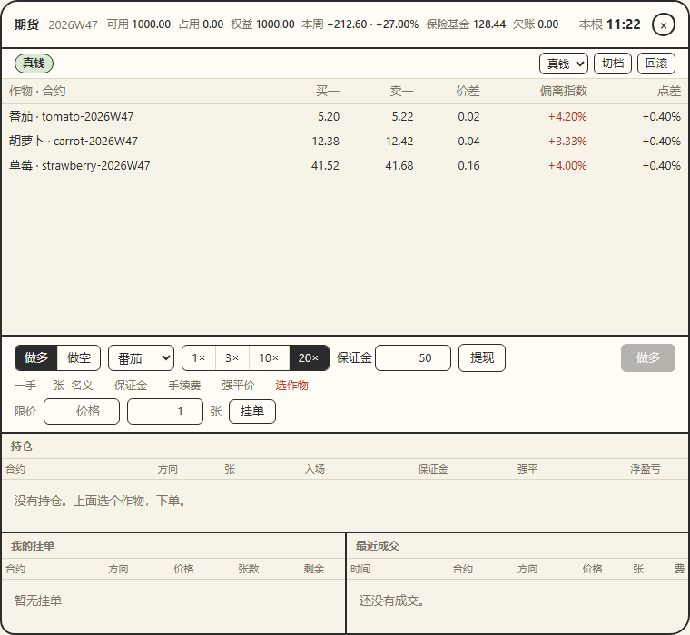
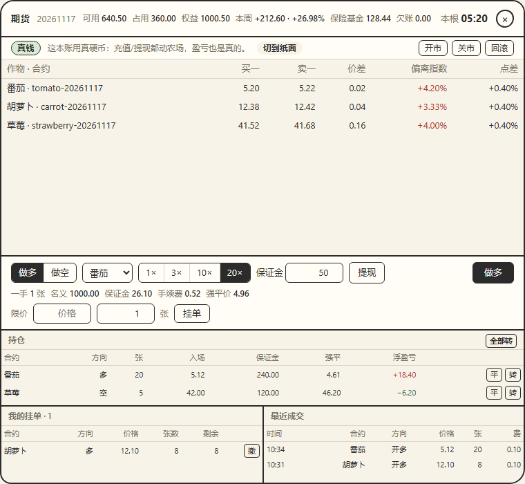
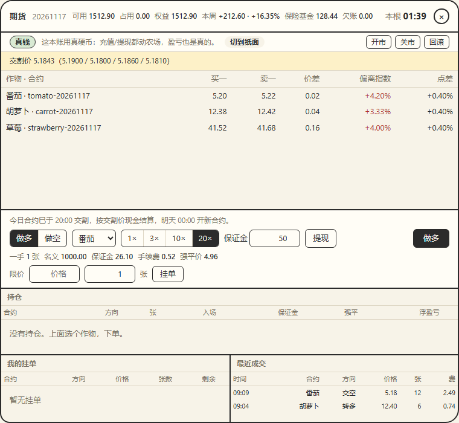
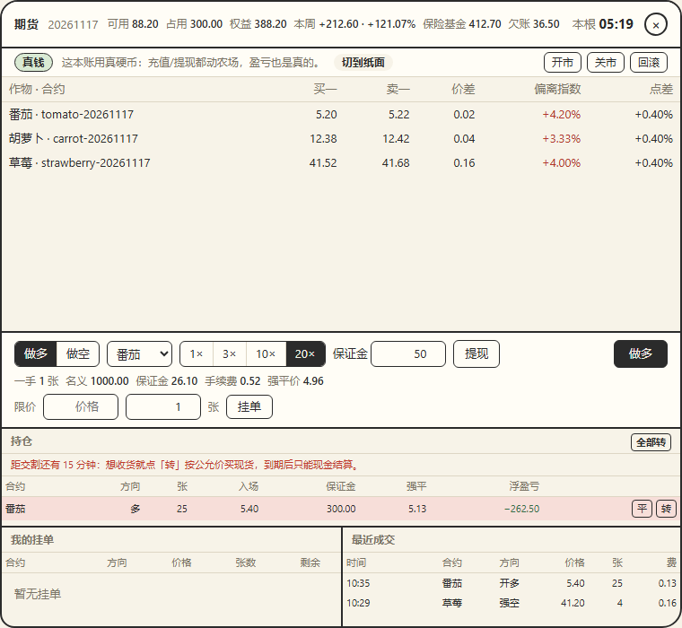

# 玩期货

一天一张合约：**00:00 开盘，20:00 交割**。中间你可以跟邻居的挂单成交，也可以吃做市商的报价；
到期只有现金结算，想拿到作物得自己在收盘前「转」成现货。

这份是玩家手册。规则表在 [README「期货」](../README.md#期货)，报文细节在
[protocol.md](protocol.md)，改规则的理由在 `docs/adr/` 和 `docs/releases/` 里。

## 一分钟上手

1. 桌面右键 →「期货」（或菜单里的「期货」）。窗口 760×700，位置会记住。
2. 顶栏第一行右侧有颗 `[纸面]`／`[真钱]` 按钮：**先决定用哪种钱**。纸面是纸做的，练手不心疼；
   真钱动的是你的农场硬币。
3. 充钱：这 1000 币从农场挪进托管账户，还能提回来。
4. 选作物、方向、杠杆、保证金，点「开多／开空」。
5. 之后盯住顶栏的倒计时。收盘前 30 分钟会亮红字：想收货就点「转」，不想就等 20:00 现金交割。

## 窗口地图



| 位置 | 有什么 |
| --- | --- |
| 第一行 | 合约日、可用余额、权益、占用保证金、保险基金、距收盘的倒计时、关闭 |
| 第二行 | 你现在的档位徽章（真钱／纸面）、切档按钮、今日额度与待提取、暂停交易、退出 |
| 报价表 | 每种作物一行：买一、卖一、价差、偏离（公允价相对现货指数）、价差百分比；收盘后整行变灰 |
| 下单区 | 方向（多／空）、作物、杠杆（1/3/10/20）、保证金；下面一行是限价单的价格与张数 |
| 底部 | 我的持仓（含强平价、浮盈亏、平／转）、我的挂单（可撤）、最近成交 |

## 一天的节奏

| 时间 | 发生什么 |
| --- | --- |
| 00:00 | 新合约上市，代号 `<作物>-<YYYYMMDD>`；偏离曲线重置，所有人看到同一条 |
| 00:00–20:00 | 随时开平仓、挂单；每 15 秒撮一次、盯市一次 |
| 19:30 起 | 窗口亮红字提醒交割，持仓表头出现「全部转」 |
| 20:00 | 交割价＝19:15 / 19:30 / 19:45 / 20:00 四根公允价的平均；全部仓位现金结清，挂单撤回、冻结退回 |
| 20:00–次日 00:00、整个周末 | 没有合约，**不能持仓过夜** |

## 下单：市价还是限价

- **市价开仓**（下单区第一行）：填「保证金」，系统按公允价换算成整张数（1 张 = 100 个作物）。
  先吃邻居挂着的限价单——同一合约、同一本账（纸面对纸面、真钱对真钱）、价格不比做市商差，
  按价格优先，成交价就是那张挂单的价；吃不下的部分才按做市商对手价成交。
- **限价挂单**（下面那一行）：填价格和张数，最多挂 8 条。挂上就冻结对应保证金；
  价格优先、同价先挂先成交，成交价取先挂那一单的价格；挂上那一刻如果已经能成交，会当场成交。
- **撤单**：挂单行尾的「撤」，退掉剩余未成交部分的冻结保证金。
- **平仓**：持仓行尾的「平」，按做市商报价成交（主动平仓不吃邻居的单）。

## 钱怎么算

- 名义 = 张数 × 100 × 价格；保证金 = 名义 ÷ 杠杆。
- 吃单 0.1% 名义；价差两侧各 0.2%（买一 = 公允 × 0.998，卖一 = 公允 × 1.002）；交割 0.1%。
- 手续费 90% 销毁，10% 进保险基金。

以 tomato 公允 5.00 买 1 张（名义 500）为例：

| 杠杆 | 保证金 | 价格涨 2%（5.10） | 价格跌 2%（4.90） |
| --- | --- | --- | --- |
| 1× | 500 | 浮盈 10（+2%） | 浮亏 10（−2%） |
| 3× | 166.67 | 浮盈 10（+6%） | 浮亏 10（−6%） |
| 10× | 50 | 浮盈 10（+20%） | 浮亏 10（−20%） |
| 20× | 25 | 浮盈 10（+40%） | 浮亏 10（−40%），再跌 3% 就爆 |

限额：每个账户每天能开 **max(5,000, 5 × 权益) 名义**的新仓（权益 = 余额 + 已占保证金，
所以钱多的人额度也大），单个仓位名义不超过 **20,000**，挂单最多 8 条。
纸面账户用同一套限额，只是数字是纸的。

## 谁会亏

期货是零和的：你赚的钱就是邻居亏的钱——前提是那一单跟邻居成交了。跟做市商成交的部分，
钱不进任何人的口袋（只有手续费被烧掉）。所以这里没法指名道姓伤谁，只能在一个有流动性的
方向上摆单、等别人来吃。

## 到期两条路



- **现金交割**（默认，什么也不用做）：20:00 按交割价结清，钱回托管账户。
- **转现货**：收盘前随时把持仓按公允价换成作物入库，可以部分转，保证金按张数比例释放；
  要花托管余额买，钱不够或仓库放不下的那几笔会被跳过。
  持仓行尾的「转」是一笔一笔转，表头的「全部转」是一次转完（最多 8 笔）。

**交割只有现金一种，没有实物交割。** 想拿到作物必须在收盘前自己转。



交割完成后报价表上方会留一条交割价：`交割价 5.1843（5.1900 / 5.1800 / 5.1860 / 5.1810）`，
括号里就是那四根公允价，可以自己核对。

## 什么时候会爆

每 15 秒按价格路径扫一次：`保证金 + 浮亏 ≤ 0` 就按那一刻的公允价平掉，亏损上限就是保证金。

| 杠杆 | 逆行多少爆仓 |
| --- | --- |
| 1× | 不会爆（最坏亏光本金，也就是全款） |
| 3× | 33.3% |
| 10× | 10% |
| 20× | 5% |

公允价是 σ 0.4%（半衰期 30 分钟，每 15 秒一步）的均值回归随机游走，正常情况下一天走不出 5%；
但有人在薄的时候推一把就不一样了——**20× 不是印钞机，是彩票**。



爆仓以后：收不上来的钱先由保险基金补（手续费里那 10%），基金也空了就记欠账，**你的余额永不为负**。

## 三颗按钮，各管各的

| 按钮 | 作用 | 只管 |
| --- | --- | --- |
| 切到真钱／切到纸面 | `futures-account-mode` | 自己这本账 |
| 暂停交易／继续交易 | `futures-pause` | 自己的新仓与新挂单；平仓、撤单、转现货、提现照常 |
| 退出 | `futures-rollback` | 自己的仓位按公允价强平、余额退回自己农场，然后关掉这本账 |

房主只是记账员：能排序、记账、广播。关不了你的市，也退不了你的钱；账本每 30 秒复制到每一台，
房主掉线换人最多丢半分钟。

## 常见报错对照

| 返回 | 意思 | 怎么办 |
| --- | --- | --- |
| `no-balance` | 托管余额不够保证金＋手续费 | 充值，或减小保证金 |
| `daily-cap` | 今天开的新仓额度（`max(5,000, 5 × 权益)` 名义）用完了 | 明天再来，或先平掉一些 |
| `position-limit` | 单个仓位名义超过 20,000 | 拆成几笔，或降杠杆 |
| `order-limit` | 挂单满 8 条 | 撤掉几条 |
| `paused` | 你自己按了暂停 | 点「继续交易」 |
| `disabled` | 你退出过这本账 | 这本账停了，得重新开户（充值即可） |
| `market-closed` / `contract-expired` | 现在没有可交易的合约（收盘后或周末） | 等下一个交易日 00:00 |
| `bad-lots` / `bad-price` / `bad-margin` / `bad-leverage` | 参数不合法 | 张数 ≥1、价格 >0、保证金 ≥1、杠杆只能是 1/3/10/20 |
| `self-trade` | 想跟自己的挂单成交 | 换个方向或价格 |
| `not-owner` | 这份账在房主那台（你已经不是房主） | 先平仓、把余额提回农场 |
| `no-space` | 仓库放不下要转的作物 | 先收菜腾地方 |

## HTTP 速查

宿主在 `http://127.0.0.1:<端口>`，动作都走 `POST /dsh-zoo/action`：

```json
{"action":"futures-deposit","coins":1000}
{"action":"futures-withdraw","coins":200}
{"action":"futures-open","cropId":"tomato","side":"long","margin":50,"leverage":10}
{"action":"futures-close","positionId":"<持仓 id>"}
{"action":"futures-place","cropId":"tomato","side":"short","price":5.05,"lots":1,"leverage":10}
{"action":"futures-cancel","orderId":"<挂单 id>"}
{"action":"futures-convert","positionId":"<持仓 id>","lots":1}
{"action":"futures-convert-all","positions":[{"id":"<持仓 id>","lots":1}]}
{"action":"futures-account-mode","accountMode":"live"}
{"action":"futures-pause","paused":true}
{"action":"futures-rollback"}
```

## 记住三件事

1. **你的单子和邻居的单子直接对上了**——你赚的就是他亏的。
2. **20 倍逆行 5% 就爆，10 倍 10%，3 倍 33%**。
3. **20:00 收工，想拿货得自己「转」**。
